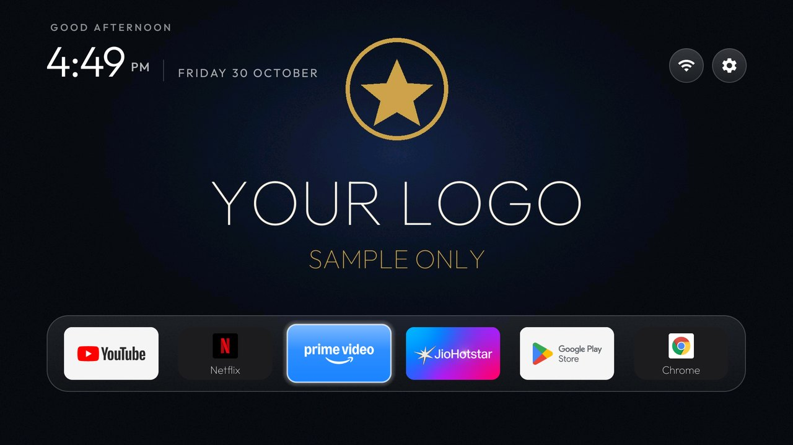
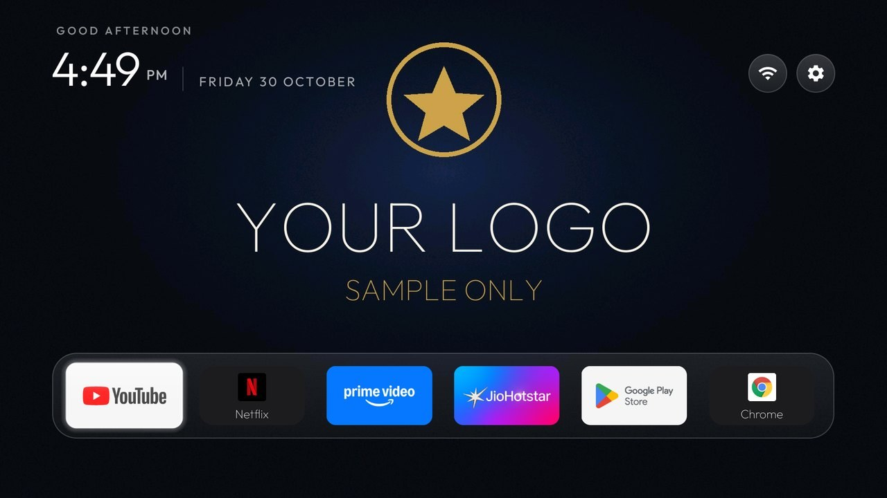
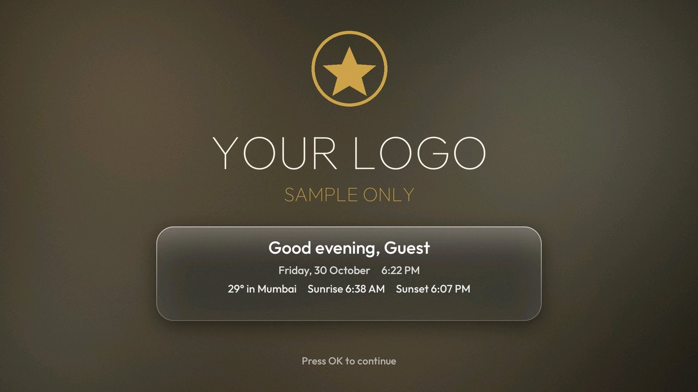
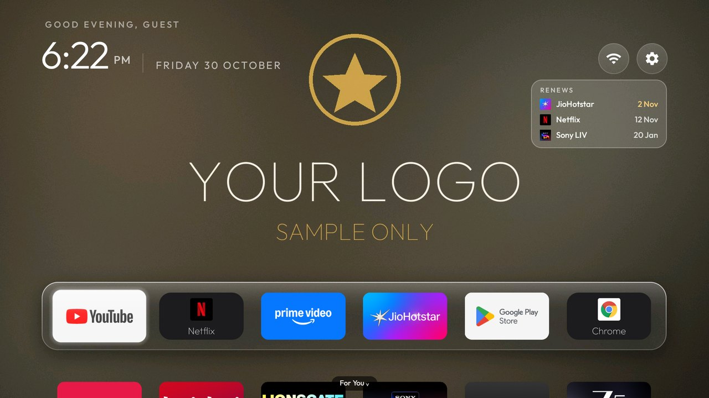
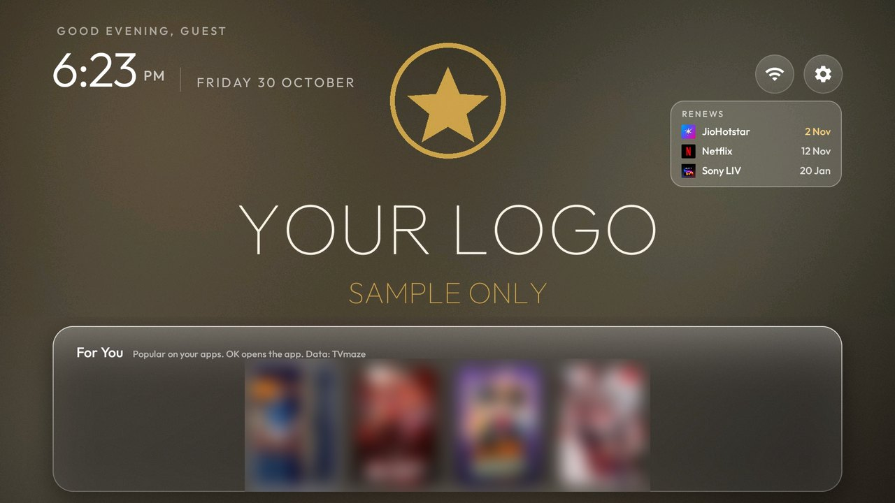
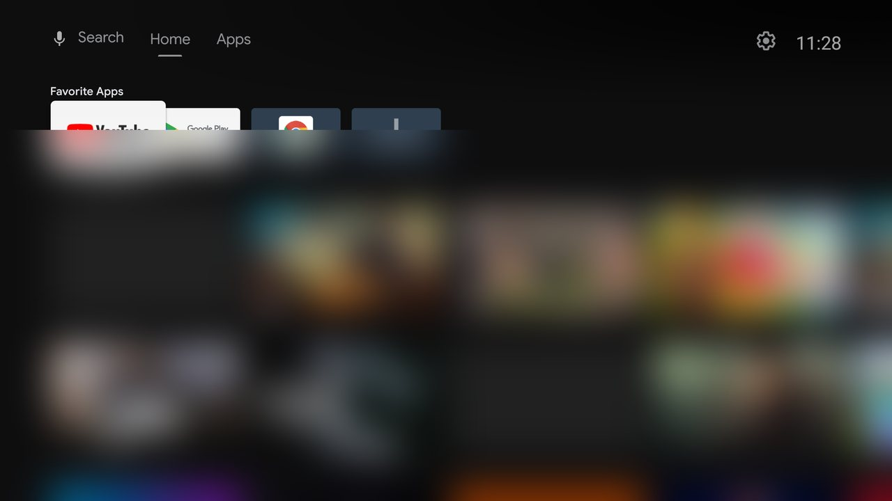
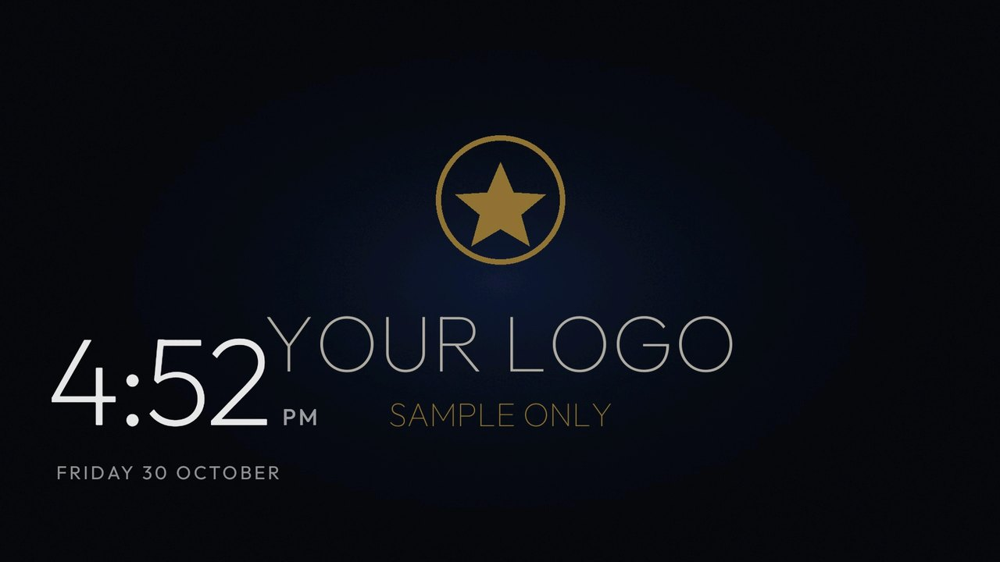
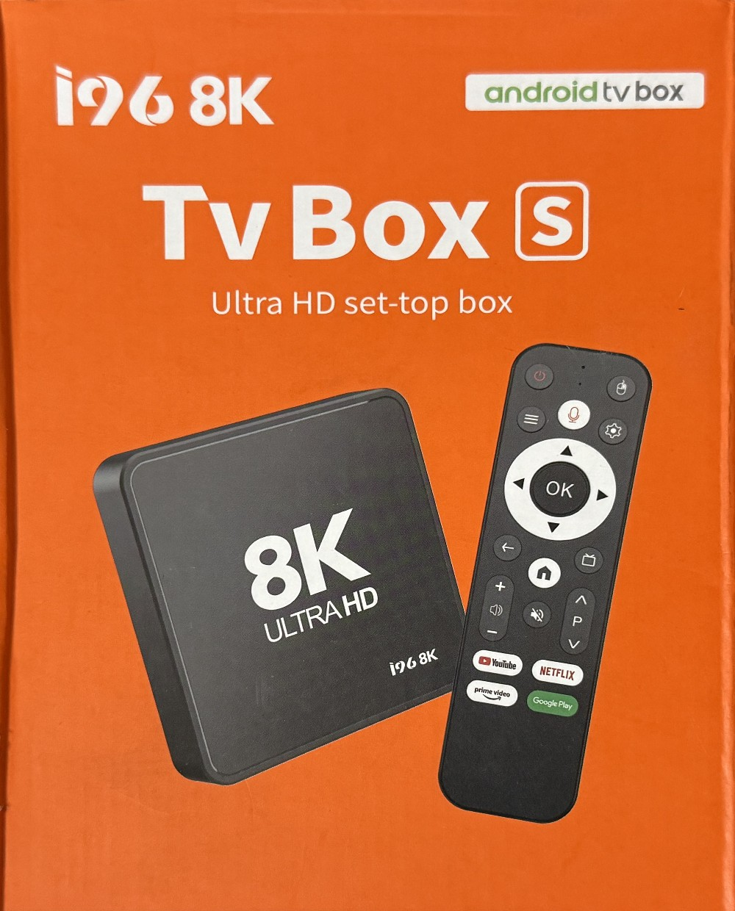

<div align="center">

# TVBox Revive

**A free launcher, debloater and ad blocker for Android TV boxes and Android TVs.**
Replace the slow stock home screen, block ads, and put your own logo on the screen, in about two minutes.

No root. No flashing. One command to undo.

[Install](#install) · [Compatibility](#compatibility) · [Results](#measured-results) · [Designs](#designs) · [Your logo](#your-logo) · [Undo](#undo-everything)



</div>

> **Compatibility warning: do not install device-specific optimization profiles on unverified hardware.** The installer checks
> the firmware and refuses any device it was not tested on. Read [compatibility](#compatibility) first.

## Why this exists

Cheap Android TV boxes are slow, full of ads, and often not what the label says. One box we tested was sold as Android 14 and 8K. It was
really Android 9 and 1080p, and it arrived with hidden apps quietly using the network: more than **160 MB in about two hours** with nobody
using it. After setup, the same system account moved about **1 KB per boot**.

## Measured results

From the first verified device, an I96 8K box with 1 GB of RAM. Your results depend on your device. Median of 3 reboots with 5 idle
minutes each, using the same script before and after: [benchmarks](benchmarks/).

| Metric | Before | After | Change |
|---|---:|---:|---:|
| Launcher memory (PSS) | 54.2 MB | 19.8 MB | **-63.4%** |
| Janky frames on Home | 54.1% | 2.47% | **-95.4%** |
| Launcher cold start | 1,723 ms | 897 ms | **-47.9%** |
| Hidden system traffic, per boot | 0.7-8.4 MB each way | about 1 KB | **over -99%** |
| Compressed swap free | 426 MB | 558 MB | **+30.9%** |
| Available RAM | 460 MB (419-473) | 494 MB (488-495) | **+7.3%** |
| Idle CPU | 6.8% | 5.4% | -20.6% |
| Boot to Home | 38.9 s | 38.1 s | -2.1% |

Honest notes: available RAM rose less than the raw savings suggest, because Android keeps more apps in real memory once it stops
compressing them, which is why swap improved so much. Focus movement takes longer on the new launcher (416 ms against 250 ms), because the
highlight glides instead of snapping. These numbers are for Design 1. Full results, including free RAM and app launch times, are in the
[benchmark report](devices/i96-8k-hi3798mv300/benchmarks/README.md).

## What you get

- **A fast home screen.** A 580 KB launcher with no internet permission, built for the remote.
- **Your own logo** on Home and the screensaver, with the whole design recoloured to match it.
- **Saved designs** that you can switch between in seconds, including a liquid glass look.
- **A welcome screen** led by your logo, with your name, the time, temperature, sunrise and sunset. OK slides it away.
- **A renewals panel** with each app's real logo, showing when your subscriptions renew.
- **A For You panel** with four popular shows from the apps you have, ranked by what you open most.
- **Your choice of what goes.** The installer lists each app and its side effects, and you decide what to keep.
- **Debloating** that disables apps instead of deleting them, so everything can come back.
- **Ad blocking** through AdGuard DNS. Optional.
- **A safety net:** dry run, automatic backup, a health check after install and one-command undo.
- **Firmware matching,** so a debloat list can never land on a device it was not tested on.

## See it

| Design 1, Home | Design 2, welcome screen |
|---|---|
|  |  |
| **Design 2, Home** | **Design 2, For You** (posters blurred here) |
|  |  |
| **Stock Home, before** (thumbnails blurred) | **Screensaver** |
|  |  |

All screenshots come from a real box. "YOUR LOGO" is a sample used only for these pictures. If you give no logo, that space stays empty.

## Compatibility

| Level | Devices | What you get |
|---|---|---|
| **Verified** | <br>I96 8K, firmware `I96_8K-20251222-301SMSX300` | Everything, including the tested debloat profile |
| **Universal, untested** | Other Android TVs and boxes on Android 8 or newer with ADB access | Launcher, designs, your logo, ad blocking and undo. No debloat |
| **Not supported** | Samsung Tizen, LG webOS, Roku | These do not run Android |

Universal mode has only been tested on the verified box so far. Android 11+ devices can need ADB pairing first, and some brands make it
harder to replace Home. If you try another device, please [report what happened](../../issues), so it can be added here. Better still,
[add a device profile](devices/README.md).

## Install

**You need:** a Mac or Linux computer on the same network as the device, Python 3, and network debugging turned on in the device's
developer options. Windows is not tested.

```bash
git clone https://github.com/chiragjain307/tvbox-revive.git
cd tvbox-revive
./install.sh --dry-run <box ip>     # shows every planned change, and changes nothing
./install.sh <box ip>               # verified devices, about 2 minutes 20 seconds
./install.sh --universal <box ip>   # any other Android 8+ device: launcher, design and DNS, no debloat
```

The device's IP address is in Settings > Network & Internet. To set up several identical boxes, list them all. They run one after another,
and the installer asks about your logo once.

```bash
./install.sh 192.168.1.50 192.168.1.51 192.168.1.52
```

After installing, sign in to your apps. Then turn off network debugging on the box. See [SECURITY.md](SECURITY.md).

## Your logo

Each run asks **"Apply a new logo? (y/N)"**. Answer yes and give it a file, and the logo appears on Home and the screensaver.

| Your file | What happens |
|---|---|
| Transparent PNG | Used as it is |
| Dark logo on white | The white goes, and the dark parts turn light for the dark screen |
| Logo on a dark colour | The background goes, and the colours stay |

The design then takes its colours from your logo, so the whole screen matches. Your logo stays in `~/.tvbox-revive` on your computer. This
repository never stores one, and a check blocks any push that would include one.

## Your apps, your choice

Before anything changes, the installer lists every app it suggests disabling, why, and what you would lose. You type the numbers to keep. Your
choice is saved, so identical boxes can reuse it with `--saved-apps`. Nothing is uninstalled, and `./undo.sh` brings everything back.

## Designs

| Design | Look |
|---|---|
| `01-navy-gold` | Clean and dark, with your logo centred on Home |
| `02-liquid-glass` | Frosted glass, a welcome screen, renewals, and a For You panel on the Down key |

```bash
./design.sh list                          # saved designs
./design.sh 02-liquid-glass <box ip>      # switch, in about 20 seconds
```

Switching changes only the look. Design 2 asks for a name and a city the first time, and installs a tiny helper app. The glass is
baked into the pictures on your computer, because budget GPUs cannot blur live, so it costs the box almost nothing. Add your own designs in
`designs/`: see the [design system](docs/design-system/README.md) and the [settings reference](docs/THEME_KEYS.md).

## Renewals

Apps do not share their billing dates with anything else on the device, so nothing can read them automatically. Enter each subscription
once, and monthly or yearly dates roll forward by themselves.

```bash
./renewals.sh <box ip>
```

## For You

Press Down from the last row of apps, and a glass panel slides up with four popular shows. It keeps to the apps you have installed and favours
the ones you open most. OK opens that app. Android does not let a launcher read your watch history or open a show directly, so this means popular
on your apps, not picked from what you watched. With no internet it shows your four most-used apps instead.

## Live data and privacy

The launcher has no internet permission in any design. Design 2 installs a separate 11 KB helper that holds the only internet access. It has no
screen and no background service, and it fetches only when the launcher asks:

| Data | From | Sent | How often |
|---|---|---|---|
| Temperature | [Open-Meteo](https://open-meteo.com/) | Your city's coordinates | At most every 30 minutes |
| Shows and posters | [TVmaze](https://www.tvmaze.com/api), licensed CC BY-SA | Nothing about you | At most every 12 hours |

Sunrise and sunset are calculated on the device. TVmaze coverage of regional shows is limited. Open-Meteo's free service is for non-commercial use,
so check its terms before using this in a business.

## Ad blocking

The installer turns on Android's Private DNS with `dns.adguard-dns.com`. Skip it with `--no-dns`.

- **It blocks** ad and tracker domains across every app on the box.
- **It does not block YouTube ads,** which come from the same domains as the videos.
- **Privacy trade-off:** AdGuard can see every domain the box looks up.

## Undo everything

```bash
./undo.sh <box ip>
```

This restores the disabled apps, stock Home and your DNS settings, and removes the launcher. It takes about 15 seconds. The
[recovery guide](docs/RECOVERY_GUIDE.md) covers every other case, with no ADB knowledge needed.

Backups contain configuration only: package states and settings. They hold no app data and no firmware.

## Known limitations

- **It cannot fix firmware.** Anything built into a device's firmware stays there. Treat a budget box as untrusted, and put it on a
  guest network if you can.
- **No boot logo.** Changing the boot screen needs root or flashing, which this project avoids.
- **Only one device is verified so far.** Everything else is untested until someone reports back.
- **Windows is not tested.**

On the verified I96 8K specifically:

- About 1 KB still goes to the vendor's server at each boot. We have not found what sends it.
- The box is not fully stable under heavy work. In about 10 hours of testing, a restart command froze twice and needed a power cycle, and
  twice it dropped off the network during app installs, then reset itself after about 2 minutes. The cause is unknown.
- Voice search keeps a process in memory, because stopping it breaks the voice button.
- Netflix and Prime Video playback was not tested, because the test box was not signed in.

## For developers

```bash
./build.sh                  # launcher tests and build
tools/check_public.sh       # check for private data before pushing
```

| Folder | Holds |
|---|---|
| `launcher/` | The launcher, and the helper app in `launcher/helper/` |
| `devices/` | One verified profile per firmware build |
| `designs/` | Saved looks |
| `tools/` | Installer helpers, backup, health check |
| `benchmarks/` | Measurement and test scripts |
| `docs/` | Guides and reference |

See [CONTRIBUTING.md](CONTRIBUTING.md), [CHANGELOG.md](CHANGELOG.md) and the [project inventory](docs/PROJECT_INVENTORY.md).

## License

MIT, free to use and modify. See [LICENSE](LICENSE). The Outfit font and the bundled icons have their own licenses in `launcher/`.

Maintained by [Chirag](https://github.com/chiragjain307). If this helped your box, please give it a star.
