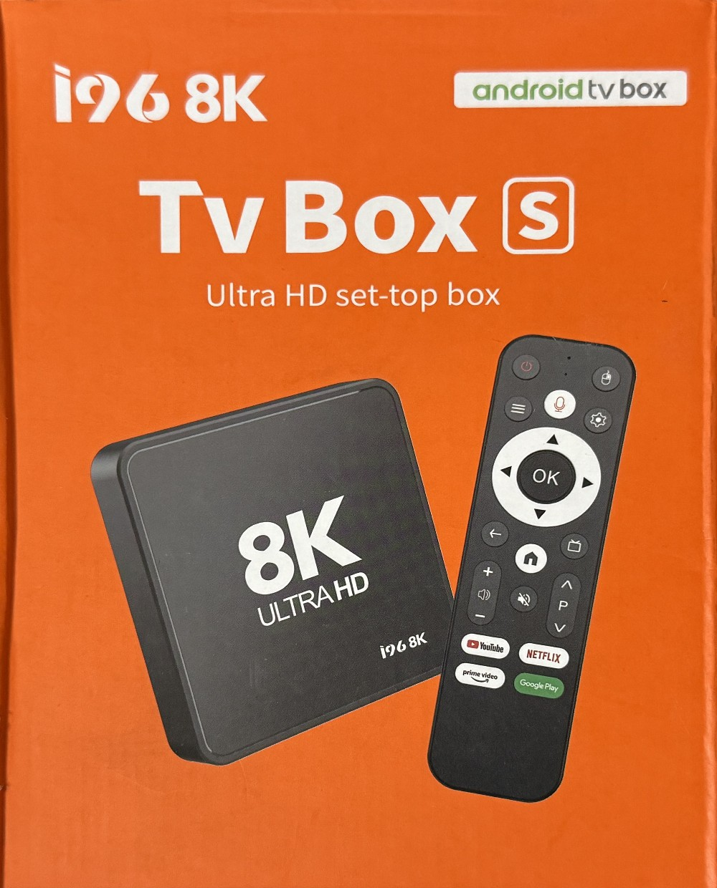

# I96 8K hardware

The retail box and the system properties claim more than the hardware delivers. These are the values read
from the running box.

| Item | Label or property says | Actually is |
|---|---|---|
| Resolution | 8K Ultra HD | 1920x1080 at 60 Hz, the only mode offered |
| Android | 14 | Android 9, SDK 28, security patch 2019-03-05 |
| Chip | AMLOGIC | HiSilicon Hi3798MV300 |
| CPU | | 4 x Cortex-A53, 32-bit userspace (`armeabi-v7a`) |
| GPU | | Mali-450 MP, OpenGL ES 2.0 |
| RAM | 1 GB (1,048,576 kB) | The exact round figure looks hard-coded. Memory zones add up to about 927 MB |
| Swap | | zram, 596 MB, lzo |
| Storage | Android reports exactly 8 GB | `/data` is really 4.0 GB, `/system` 984 MB at 89%. Only `df` shows the true size |
| Network | | Wi-Fi only |
| Remote | | Bluetooth LE with microphone, plus IR |
| HDMI inputs | | None, output only |
| Casting | | Not supported: no cast service on the box |
| Build | | userdebug, test-keys, SELinux permissive |
| Build ID | | `I96_8K-20251222-301SMSX300` |
